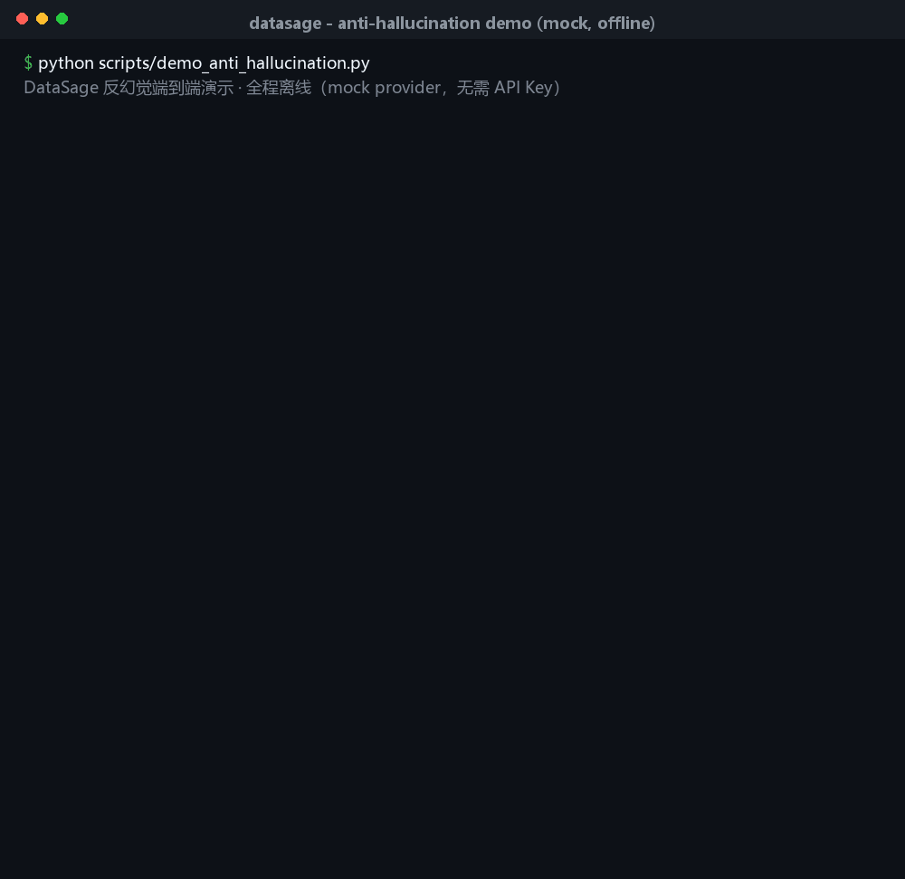

# DataSage

> 可信数据分析引擎：上传 CSV/Excel，用自然语言提问，大模型生成 pandas 代码 →
> 受限沙箱执行 → 三层验证 → **答案数字逐个回溯到真实执行结果**，
> 幻觉数字被自动拦截并带证据重写，让答案里的每一个数字都可溯源。
>
> 🔑 **零 API Key、全程离线可演示**：内置 mock LLM，`docker compose up` 即用。

## 反幻觉演示（离线 mock，无需 Key）



提问「各地区销售额汇总，总销售额是多少？哪个地区最高？」，沙箱真实结果只有
2450 / 2040 / 1390 / 640 四个数字。演示模式下初稿刻意编造「总销售额 8932 元、
同比增长 46%」，数字回溯在真实结果（单元格 / 行列数 / 求和 / 均值 / 百分比与倍数
候选）中全部比对失败 → 红色标记为幻觉 → 把证据喂回模型自动重生成 →
终稿 5/5 个数字全部可溯源（绿色下划线，点击可看行列证据）。

纯终端复现（不依赖前后端服务）：

```bash
cd backend
pip install -r requirements.txt -r requirements-dev.txt   # Pillow 仅录屏需要
DATASAGE_DEMO_HALLUCINATION=true python scripts/demo_anti_hallucination.py
```

## 工作流

```
CSV/Excel 上传
      │
      ▼
 schema 提取（列名 / 类型 / 示例 / 数值区间）
      │
      ▼
 自然语言提问
      │
      ▼
 LLM 生成 pandas 代码 ──► 受限沙箱执行 ──► 三层结果验证
 （静态校验 / 自动修复）     （子进程隔离、     ① syntax 执行结构
                            禁网、白名单、      ② sanity  语义合理
                            超时 kill）         ③ consistency 一致性
                                                      │
                            数字回溯 NumericBacktracker ◄┘
                            （答案中每个数字 → 真实结果表找证据）
                                      │
                          发现幻觉？──是──► 证据回填 prompt，自动重生成（≤2 轮）
                                      │否
                                      ▼
                            带逐字溯源标注的最终答案 + 图表推荐
```

**关键约束：模型从头到尾只能看到 schema 和沙箱执行后的结果表，拿不到全量数据，
也看不到回溯器代码。** 答案里的数字必须在真实结果中找到证据，否则即判幻觉。

## 快速开始

### 方式一：Docker Compose（推荐，两条命令）

前置：安装 Docker Desktop / Engine。

```bash
# 可选：打开反幻觉演示开关（默认关闭）。Windows PowerShell：
#   $env:DATASAGE_DEMO_HALLUCINATION='true'
# macOS / Linux：
#   export DATASAGE_DEMO_HALLUCINATION=true
docker compose up --build
```

- 前端：<http://localhost:5173>（容器内 Vite，`/api`、`/health` 代理到后端容器）
- 后端：<http://localhost:8000> ，交互文档 <http://localhost:8000/docs>
- 默认 `DATASAGE_LLM_PROVIDER=mock`，**不需要任何 API Key，断网也能跑完整链路**
- SQLite 与上传文件持久化在命名卷 `backend-data` / `backend-uploads`

接真实大模型：在**仓库根目录**创建 `.env`（键名参考 [`backend/.env.example`](backend/.env.example)）：

```env
DATASAGE_LLM_PROVIDER=openai
LLM_API_KEY=sk-xxxxxxxx
LLM_BASE_URL=https://api.deepseek.com/v1   # Moonshot / 通义千问换对应兼容地址
LLM_MODEL=deepseek-chat
```

然后重新 `docker compose up`。默认值见 [`docker-compose.yml`](docker-compose.yml)。

### 方式二：手动启动（开发模式）

后端（Python 3.11+）：

```bash
cd backend
python -m venv .venv
# Windows
.venv\Scripts\activate
# macOS / Linux
# source .venv/bin/activate

pip install -r requirements.txt
copy .env.example .env    # 可选；不复制即用默认值（mock 离线模式）

uvicorn app.main:app --reload
```

后端启动后另开终端启动前端（Node 20+）：

```bash
cd frontend
npm install
npm run dev
```

打开 <http://localhost:5173>：

1. 左侧 **上传 CSV/Excel**，或点击 **「加载示例数据」** 一键体验；
2. 中间输入问题，如 `各地区销售额汇总，总销售额是多少？哪个地区最高？`；
3. 展开 计划 / 代码 / 执行 / 验证 / 答案 五步折叠卡查看完整分析过程
   （被拦截的幻觉初稿保留在「答案生成」卡片中，红色高亮）；
4. 点击终稿中 <u>带下划线的数字</u>，右侧滑出证据抽屉：判定依据、行列定位、
   原始结果表联动高亮。

前端生产构建（含严格 TS 检查）：`npm run build`。

## 反幻觉原理

1. **受限沙箱执行**：LLM 生成的 pandas 代码在独立子进程中运行，禁网、内置
   白名单、禁止危险导入、超时强制终止；执行失败把报错回喂模型自动修复。
2. **三层结果验证**：syntax（结构是否正常）→ sanity（空表 / 除零 / 异常值等
   语义检查）→ consistency（结果与问题、schema 是否一致）。
3. **数字回溯（核心）**：`NumericBacktracker` 从答案文本中抽取所有数字，在真实
   结果表中按四类证据位置逐一比对——单元格原值 / 行列数等表元数据 / 求和均值等
   聚合派生值 / 百分比与倍数候选；命中即记录行列坐标，未命中即判幻觉。
4. **带证据自动重生成**：发现幻觉后，把「哪些数字找不到证据、允许引用的真实值
   有哪些」拼进修复 prompt 重新生成，最多 2 轮；每轮初稿与判定都完整保留并
   下发前端，可审计、可复盘。
5. **逐字溯源 UI**：终稿每个数字渲染为可点击标注，红色 = 幻觉（仅初稿，保留留档），
   绿色下划线 = 可溯源，点击展示行列证据并高亮结果表。

## 环境变量

| 变量 | 说明 | 默认值 |
| --- | --- | --- |
| `APP_NAME` | 应用名称 | `DataSage` |
| `DEBUG` | 调试模式（SQL 回显等） | `true` |
| `DATASAGE_LLM_PROVIDER` | `mock` / `openai` / `anthropic` | `mock` |
| `LLM_API_KEY` | LLM API 密钥（mock 留空） | 空 |
| `LLM_BASE_URL` | OpenAI 兼容地址（DeepSeek / Moonshot / 通义千问） | `https://api.deepseek.com/v1` |
| `LLM_MODEL` | 模型名称 | `deepseek-chat` |
| `DATASAGE_DEMO_HALLUCINATION` | 演示开关：`true` 时 mock 初稿刻意编造数字并被拦截重写（仅 mock 生效） | `false` |
| `DATABASE_URL` | 数据库地址（`sqlite:///` 自动补 `aiosqlite` 驱动） | `sqlite:///./datasage.db` |
| `VITE_PROXY_TARGET` | 仅前端：Vite 开发服务器代理目标 | `http://localhost:8000` |

后端变量文档见 [`backend/.env.example`](backend/.env.example)。

## 技术栈

| 层 | 技术 |
| --- | --- |
| 后端 | Python 3.11 · FastAPI · pandas · SQLAlchemy 2 (async) · aiosqlite · httpx · pydantic-settings |
| 前端 | React 18 · Vite 6 · TypeScript 5（strict）· Tailwind CSS 3 · Zustand · Recharts |
| LLM | OpenAI 兼容协议直连（默认 DeepSeek，兼通 Moonshot / 通义千问），内置 `mock` 离线桩 |
| 沙箱 | 受限子进程（白名单 / 禁危险导入 / 禁网 / 超时 kill）；容器级隔离见 `docker/sandbox.py` 骨架 |
| 部署 | Docker（python:3.11-slim / node:20-alpine）+ Compose，命名卷持久化 |

## 项目结构

```
datasage/
├── backend/
│   ├── app/
│   │   ├── main.py                  # FastAPI 入口（健康检查 / CORS / lifespan）
│   │   ├── config.py                # pydantic-settings 类型安全配置
│   │   ├── database.py              # 异步 engine + get_session 依赖
│   │   ├── models.py                # DataSource / QuerySession / AnalysisStep / QueryResult
│   │   ├── llm/client.py            # mock + OpenAI 兼容 LLM 封装
│   │   ├── schema/extractor.py      # CSV/Excel schema 提取（dtype / 区间 / 示例）
│   │   ├── analysis/
│   │   │   ├── codegen.py           # LLM 代码生成 + 静态校验
│   │   │   ├── executor.py          # 受限沙箱执行 + 报错自动修复重试
│   │   │   ├── verifier.py          # 三层验证 + 数字回溯 NumericBacktracker
│   │   │   ├── answer.py            # 答案撰写 + 幻觉带证据重生成（初稿留档）
│   │   │   └── chart_advisor.py     # 纯规则图表推荐（折线 / 柱状 / 散点）
│   │   ├── services/                # 数据源 / 查询编排（datasource_service、query_service）
│   │   └── api/                     # 上传 / 示例 / 列表 / 详情 / 提问 路由
│   ├── scripts/demo_anti_hallucination.py  # 终端演示（产出 docs/demo GIF）
│   ├── tests/                       # pytest 104 项（数字回溯 / 演示模式 / 沙箱等）
│   ├── data/                        # 内置示例 CSV（sample_sales / demo_sales）
│   ├── Dockerfile · .dockerignore
│   ├── requirements.txt · requirements-dev.txt  # dev 额外含 Pillow（录屏用）
│   └── .env.example
├── frontend/
│   ├── src/
│   │   ├── pages/ChatPage.tsx       # 三栏聊天式主界面（响应式）
│   │   ├── api/{client,types}.ts    # fetch 封装 + 全接口 TS 类型
│   │   ├── store/useChatStore.ts    # Zustand 全局状态
│   │   ├── lib/{evidence,download}.ts
│   │   └── components/
│   │       ├── UploadPanel.tsx      # 拖拽上传 + 示例加载 + 历史切换
│   │       ├── SchemaCard.tsx       # 行列统计 / dtype 徽章 / 数值区间
│   │       ├── ChatMessages.tsx     # 消息流 + 加载骨架 + 引导问题
│   │       ├── ChatInput.tsx        # Enter 发送 / 自适应高度
│   │       ├── StepCard.tsx         # 5 步折叠卡（含被丢弃的幻觉初稿）
│   │       ├── AnswerPanel.tsx      # 反幻觉徽章 + 回溯通过率
│   │       ├── AnnotatedText.tsx    # 答案数字精确切片标注（红/绿）
│   │       ├── EvidencePanel.tsx    # 右侧滑出数字证据抽屉
│   │       ├── DataTable.tsx        # 证据行列高亮结果表
│   │       └── ChartPanel.tsx       # Recharts 自动可视化
│   ├── Dockerfile · .dockerignore
│   └── vite.config.ts               # /api、/health 代理（VITE_PROXY_TARGET 可配）
├── docker/sandbox.py                # 未来容器级沙箱执行器骨架
├── docs/demo/                       # 反幻觉 GIF + 文字版 transcript
├── docker-compose.yml               # 一键编排（默认 mock，零 Key 离线）
└── README.md
```

## API 一览

| 方法 | 路径 | 说明 |
| --- | --- | --- |
| `POST` | `/api/v1/datasources` | 上传 CSV/Excel 并解析 schema |
| `POST` | `/api/v1/datasources/sample` | 加载内置示例数据 |
| `GET` | `/api/v1/datasources` | 数据源列表 |
| `GET` | `/api/v1/datasources/{id}` | 数据源详情（含完整 schema） |
| `POST` | `/api/v1/query` | 发起自然语言分析，返回五步过程 + 逐字溯源 |
| `GET` | `/api/v1/sessions/{id}` | 会话详情（含完整溯源步骤） |
| `GET` | `/api/v1/sessions/{id}/report` | 导出会话分析报告 |
| `GET` | `/health` | 健康检查 |

## 当前状态

🟢 **端到端可用，已验证**：

- 后端：上传 / 示例 / schema 提取、mock + OpenAI 兼容代码生成、沙箱执行与自动
  修复、三层验证、四类证据位置数字回溯、幻觉带证据重生成（初稿留档）、规则图表
  推荐、会话溯源持久化；**pytest 104/104 通过**。
- 前端：三栏界面、五步折叠卡、红色幻觉初稿 / 绿色可溯源终稿、证据抽屉联动、
  Recharts 图表；`tsc --strict` + Vite 生产构建通过。
- 离线演示：终端脚本一键产出反幻觉 GIF，全程不访问网络；Docker Compose 实跑验证通过。

## Roadmap

- [ ] 容器级沙箱（`docker/sandbox.py`）：禁网、只读挂载、CPU/内存限制
- [ ] 真实 LLM Key 下的回归测试与多模型提示词调优
- [ ] Excel 多 Sheet、GBK 等编码文件的更广泛实测
- [ ] 多轮追问（以上一轮结果为上下文）
- [ ] 分析报告导出能力完善
