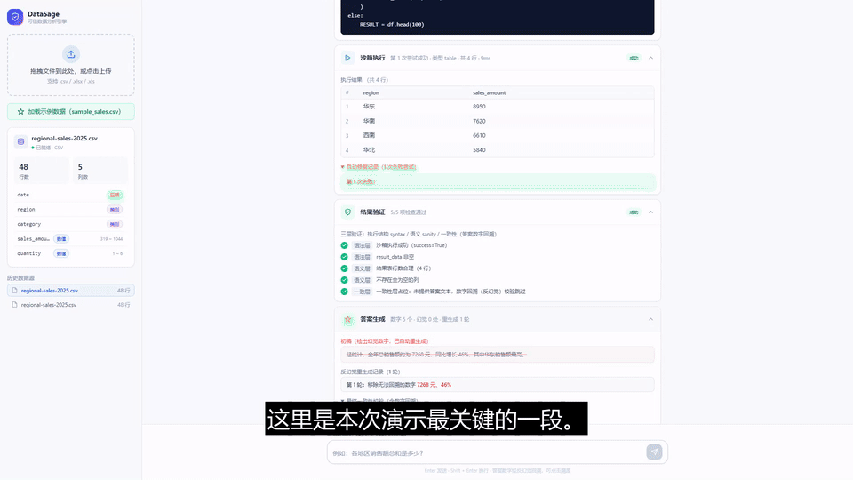
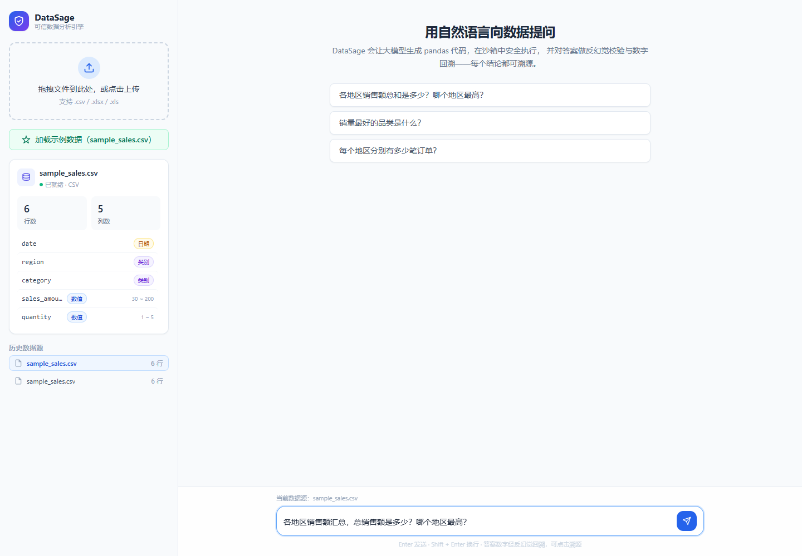
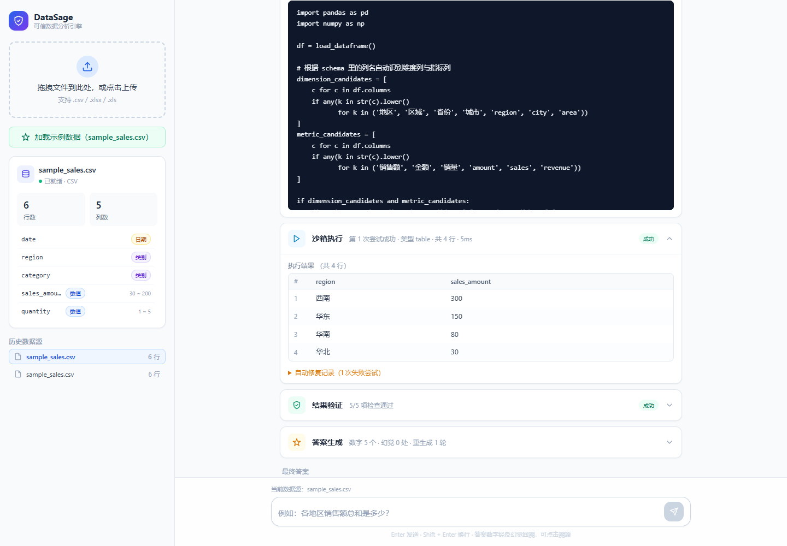
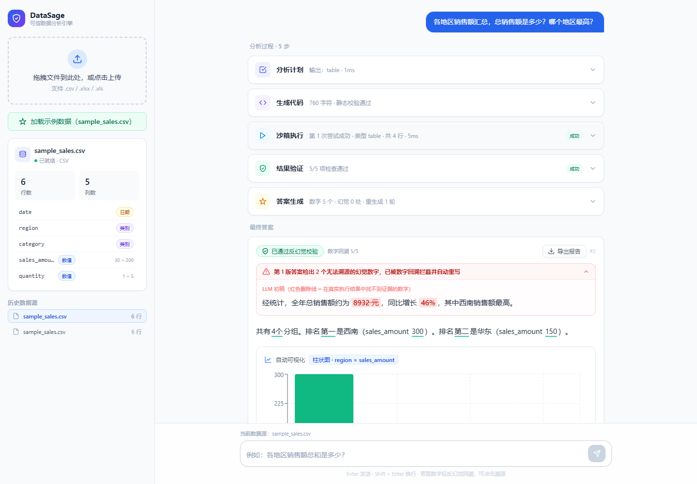
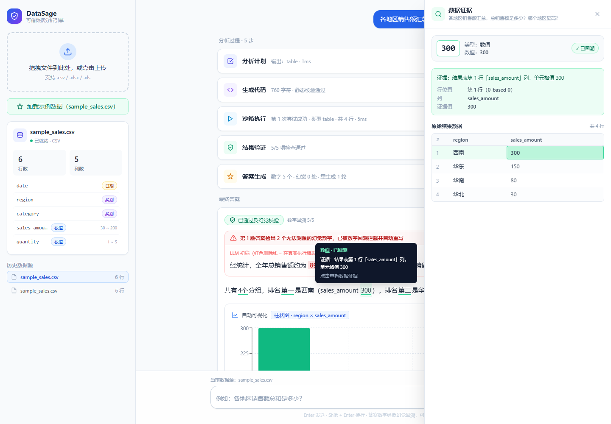

# DataSage Web UI 演示：从幻觉初稿到可回溯答案

> 本页录像来自真实本地 Web UI 操作。使用 mock provider 和 `DATASAGE_DEMO_HALLUCINATION=true` 确定性触发反幻觉链路，**不调用上游模型 API**；pandas 沙箱执行、结果验证、答案重写、持久化和证据定位均走真实应用代码。

## 新版中文录像

- **[2 分 51 秒中文精简版](../DataSage-demo-highlights.mp4)** · [独立字幕](demo/web/DataSage-demo-highlights.srt)
- **[6 分 28 秒完整版](../DataSage-demo-full.mp4)** · [独立字幕](demo/web/DataSage-demo-full.srt)

新版两版来自同一次真实完整录制，使用 48 行 CSV 示例，覆盖三层验证、故意注入无依据数字后的拦截重写、单元格证据、图表导出和关联追问。精简版仅删减重复停留，没有整片加速。

## 早期图文验证记录

示例数据共 **6 行、5 列**。问题为：

> 各地区销售额汇总，总销售额是多少？哪个地区最高？

应用生成并执行 pandas 代码，得到：

| region | sales_amount |
| --- | ---: |
| 西南 | 300 |
| 华东 | 150 |
| 华南 | 80 |
| 华北 | 30 |

随后，演示开关让 mock 初稿故意加入 `8932 元` 和 `46%`。数字回溯器在执行结果中找不到这两个数字，拦截初稿并触发 **1 轮自动重写**。最终答案为：

> 共有 4 个分组。排名第一是西南（sales_amount 300）。排名第二是华东（sales_amount 150）。

最终答案的 **5/5 个数字均可回溯**，`verified=true`、`hallucination_count=0`。

## 关键截图

### 1. 加载示例数据并提问

### 2. pandas 沙箱真实执行

### 3. 幻觉初稿被拦截并重写

### 4. 数字证据下钻

点击最终答案中的 `300`，证据抽屉定位到结果表第 1 行 `sales_amount` 列并高亮单元格。

## 演示边界

mock 模式用于离线、可重复地展示产品交互和可信分析链路；幻觉初稿是**刻意注入的演示输入**。这里的 `5/5` 仅描述本次内置样本最终答案的数字回溯结果，**不代表真实模型准确率、通用反幻觉能力或生产环境表现**。
